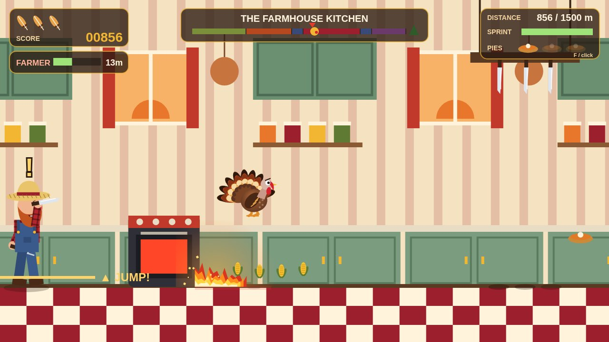
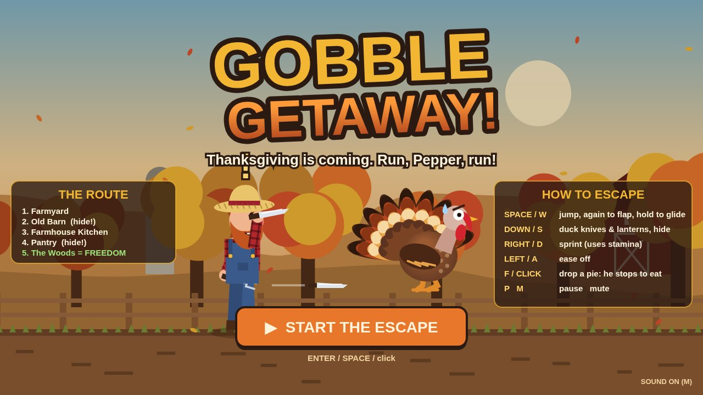
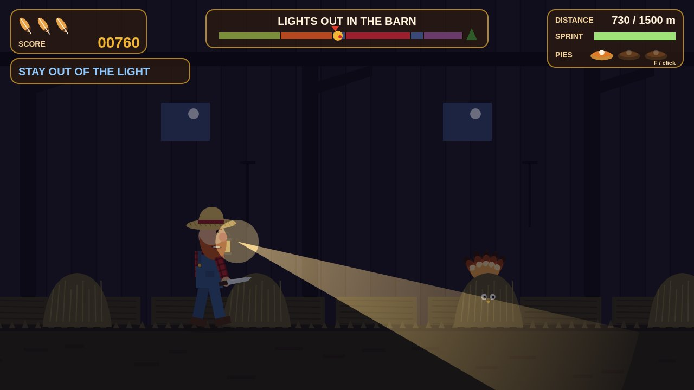
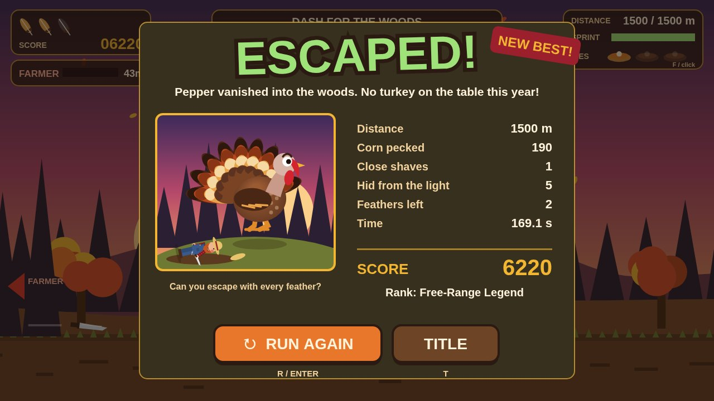

# Gobble Getaway

[](https://make.fun/bounty/turkey-run-game-01)
[](https://make.fun/bounty/turkey-run-game-01)
[](https://make.fun/bounty/turkey-run-game-01)

**Thanksgiving is coming. Run, Pepper, run!** An original turkey escape game for the make.fun bounty
*turkey-run-game-01*. Pepper the turkey flees Farmer Baste through the farmyard, the old barn, the
farmhouse kitchen and the pantry to the freedom of the woods. Dodge his thrown carving knives, leap the
oven flames, duck the barn lanterns, and hide when the lights go out.



## Play

Static files, no build step, no network: serve `game/` with any static server and open it in desktop Chrome.

```sh
node serve.ts          # http://localhost:8080
```

| Keys | Action |
| --- | --- |
| Space / W / Up | jump; press again in the air to flap once; hold while falling to glide |
| Down / S | duck under knives and lanterns; hide in hay or a cupboard during a search |
| Right / D | sprint (uses stamina); sneak forward during a search |
| Left / A | ease off |
| F / E / mouse click | drop a pumpkin pie: the farmer stops to eat it |
| P / Esc, M | pause, mute |

## The run

1. **The Farmyard**: fences, hay bales, rolling pumpkins, mud. Farmer Baste winds up ("!") and throws
   carving knives low (jump) or high (duck). He only throws when the ground ahead is clear, so every
   knife is dodgeable.
2. **The Old Barn**: pitchforks, crates and low lanterns to duck.
3. **Lights Out in the Barn**: the farmer loses you and searches with a lantern. Sneak, then hide in
   the hay when the beam swings near. Get spotted and he grabs a feather; slip away for a bonus.
4. **The Farmhouse Kitchen**: ovens glow "HOT!" before blasting flame across the floor, knife racks
   drop carving knives (watch their shadows), gravy spills send you sliding, pots and rolling pins.
5. **Hide in the Pantry**: a second search, among the cupboards.
6. **Dash for the Woods**: the farmer gives it everything. Reach the trees and you are free.

Three feathers (lives), lucky feathers to find, corn to peck, close-shave and hiding bonuses, a rank
for every run and your best score kept in the browser. All art is drawn with canvas paths and all
sound is synthesised with Web Audio in the game's own code.





## Code

`game/src/`: `main.js` (screens and loop), `run.js` (one escape attempt), `turkey.js`, `farmer.js`,
`hazards.js`, `level.js` (course spawner), `stages.js`, `config.js` (all tuning), `render.js`, `hud.js`,
`screens.js`, `effects.js`, `audio.js`, `input.js`, `save.js`, `rng.js`, `art/` (turkey, farmer,
scenery, props), plus `autopilot.js` and `shots.js`, which play real seeded runs to the moments in
the screenshots (`?shot=title|leap|kitchen|barn|caught|escaped&seed=N`).

`main.ts` hands the entry in: it copies `game/` and `screenshots/` to `/output` and writes
`dossier.json` with the kit's unchanged `vendor/makefun-game.ts`.

## License

MIT, see [LICENSE](LICENSE).
